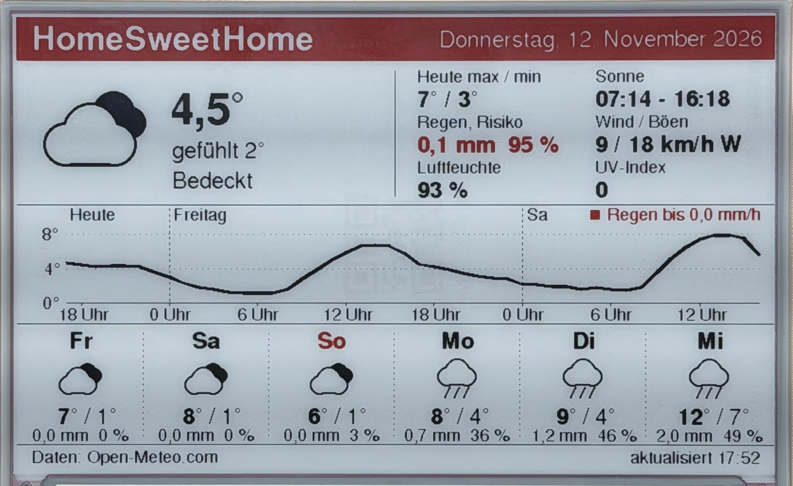

# esp32-epaper74-weather-station

Wetterstation auf einem 7,4"-E-Paper in Schwarz/Weiß/Rot aus einem SES-imagotag-Preisschild. Daten von [Open-Meteo](https://open-meteo.com), kein API-Schlüssel nötig.

*Weather station for the 7.4" black/white/red e-paper from SES-imagotag shelf labels, using Open-Meteo. Documentation is in German.*

## Anzeige

| Bereich | Inhalt |
|---|---|
| Kopfzeile | Ort und Datum |
| Jetzt (links oben) | Wettersymbol, Temperatur, gefühlte Temperatur, Beschreibung |
| Heute (rechts oben) | max/min, Sonnenauf- und -untergang, Regen und Risiko, Wind und Böen, Luftfeuchte, UV-Index |
| Verlauf | nächste 48 Stunden: Temperaturkurve (schwarz), Niederschlag (rote Balken), Tagesgrenzen, rote 0°-Linie bei Frost |
| 6 Tage | Symbol, max/min, Regenmenge und Risiko |

Rot hebt hervor: Sonntag, Frost, Regenrisiko ab 70 %, Böen ab 60 km/h, UV-Index ab 6.

## Hardware

- Panel: SES-imagotag 7,4" BWR (Pervasive E2741ES083), 800 × 480
- Board: Waveshare e-Paper ESP32 Driver Board (SKU 15823), Schalter 1 auf **B**, Schalter 2 auf **ON**
- Treiber: [ses-imagotag-7in4-bwr-epaper](https://github.com/DocBigs-Lab/ses-imagotag-7in4-bwr-epaper) (Bibliothek `Epd74`), wird von PlatformIO automatisch geladen

## Einrichten

1. `include/secrets.example.h` nach `include/secrets.h` kopieren und eintragen:
   - WLAN: `WIFI_SSID`, `WIFI_PASS`
   - Ort: `ORT_NAME` (Anzeigename, Umlaute erlaubt), `ORT_LAT` und `ORT_LON` (Koordinaten in Grad, z. B. `"52.5200"`)

   `secrets.h` steht in `.gitignore`. WLAN-Daten und Standort landen damit nicht im Repo.
2. Zeitzone, Intervall und Reinigungszeit stehen in [src/config.h](src/config.h).
3. Flashen: `pio run -t upload`. Der serielle Monitor muss dabei geschlossen sein.

Die Umgebung `lokal` (`pio run -e lokal -t upload`) nimmt den Treiber aus dem Nachbarordner `../ses-imagotag-7in4-bwr-epaper` statt von GitHub. Das ist praktisch, wenn man an beiden gleichzeitig arbeitet.

## Ablauf

- Aktualisierung zur vollen und halben Stunde (jeweils 1 Minute danach). Bei einem Fehler neuer Versuch nach 5 Minuten, das letzte gute Bild bleibt stehen.
- Nachts um 3 Uhr eine Reinigungsrunde (schwarz, rot, weiß) gegen Geisterbilder.
- Serieller Monitor (115200 Baud): `u` aktualisiert sofort, `c` startet eine Reinigungsrunde.

## Code

| Datei | Inhalt |
|---|---|
| [src/main.cpp](src/main.cpp) | WLAN, Uhrzeit (NTP), Zeitplan |
| [src/openmeteo.cpp](src/openmeteo.cpp) | Abfrage und Auswertung (ArduinoJson) |
| [src/ansicht.cpp](src/ansicht.cpp) | Layout |
| [src/icons.cpp](src/icons.cpp) | Wettersymbole als Vektorgrafik für alle WMO-Codes, nachts Mond statt Sonne |
| [src/textde.cpp](src/textde.cpp) | Umlaute und Gradzeichen auf den Adafruit-Fonts (Punkte und Kreis werden aufgemalt) |

Die Abfrage läuft über HTTP statt HTTPS. Die verwendete ESP32-Plattform (Arduino-Core 3.3.7) bringt keine TLS-Bibliothek mit. Übertragen werden nur die Koordinaten und öffentliche Wetterdaten.

## Lizenz und Daten

Code: MIT, siehe [LICENSE](LICENSE).

Wetterdaten: [Open-Meteo.com](https://open-meteo.com), Lizenz [CC BY 4.0](https://creativecommons.org/licenses/by/4.0/). Die freie API ist für nicht-kommerzielle Nutzung gedacht.
